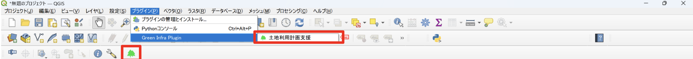
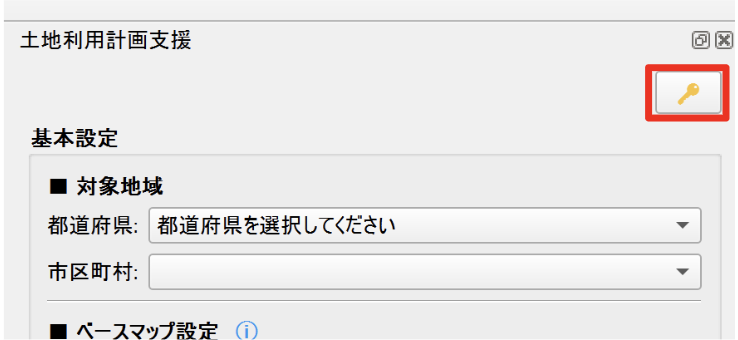
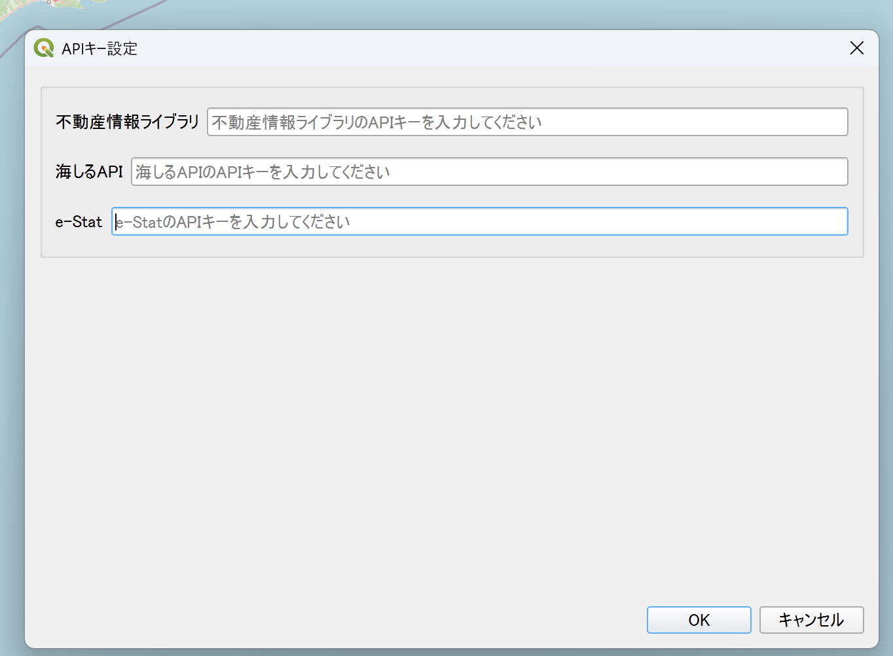
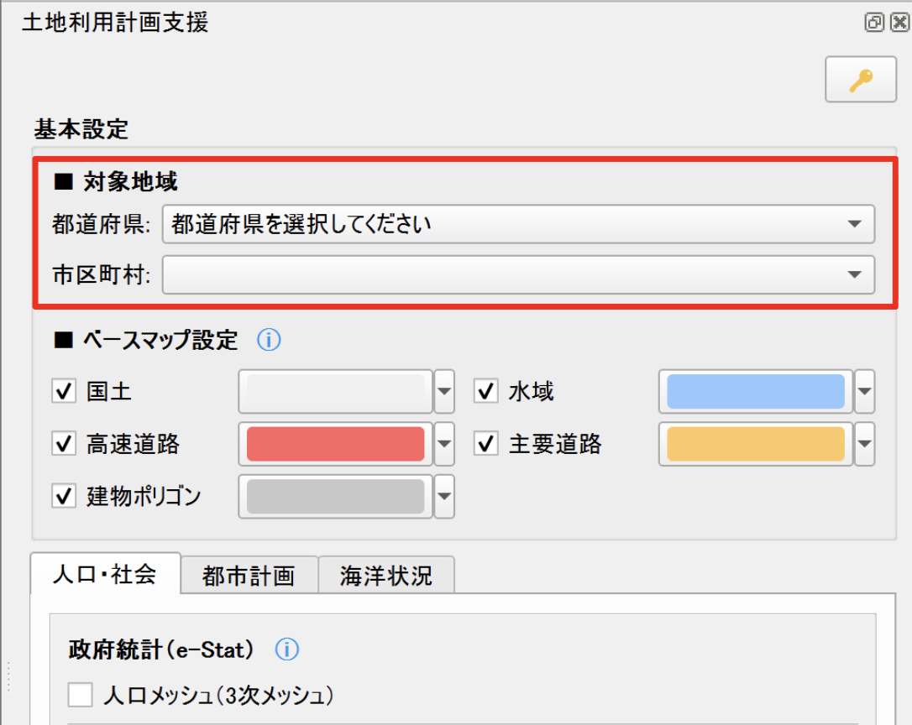
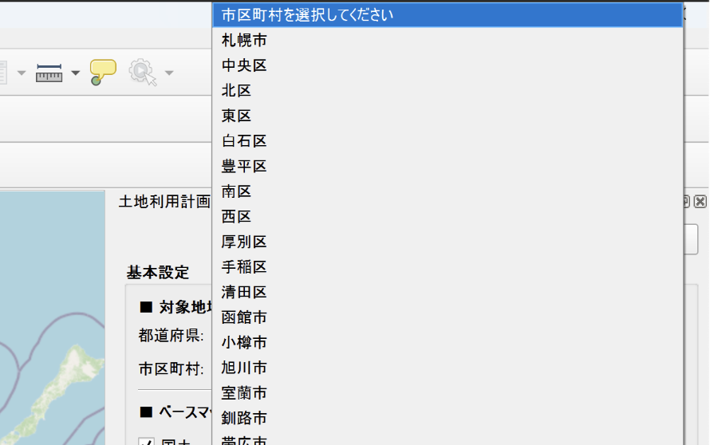
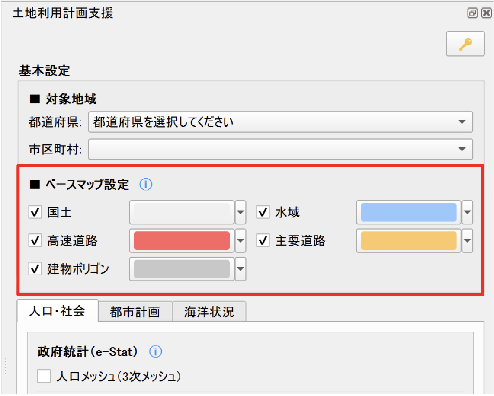
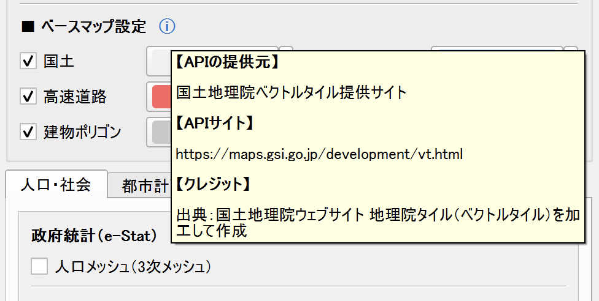

# 操作方法

## プラグインの起動

メニューまたはツールバーより土地利用計画支援プラグインを起動します。

## API キーの設定

「🔑」のアイコンをクリックし、必要な API キー設定欄に API キーを入力します。入力が完了したら「OK」ボタンを押してください。 
※API キーは、外部のデータサービスを利用するための「認証コード」のようなものです。
このプラグインでは、地図データや地理情報を取得するために必要となりますので、各サイトからご自身で発行手続きをしてください。

## 対象地域の選択

「都道府県」と「市区町村」をプルダウンから選択してください。 
市区町村は都道府県を選択するとプルダウンから選択ができるようになります。

## ベースマップの設定

### 可視化したいベースマップの選択

可視化したい項目にチェックを入れてください。 
初期設定では全てにチェックが入っているので、不要なデータはもう一度クリックしてチェックを外してください。

各項目で可視化されるデータは以下の通りです。

**国土**
- 湿地帯
- 砂礫地（領域が明瞭な場合）
- 表示範囲：ズームレベル 8 以上

**水域**
- 水域（河川、湖沼など）
- 表示範囲：ズームレベル 9 以上

**高速道路**
- 高速自動車道
- 高速自動車道トンネル
- 表示範囲：ズームレベル 7 以上

**主要道路**
- 主要な道路
- 表示範囲：ズームレベル 9 以上

**建物ポリゴン**
- 普通建物
- 堅ろう建物
- 高層建物
- 普通無壁舎
- 堅ろう無壁舎
- 表示範囲：ズームレベル 14 以上

### 使用データに関する情報について

「ベースマップ設定」の文字の横の「ⓘ」にカーソルを合わせると接続している API の情報を見ることができます。

## API データの可視化

このプラグインでは、「人口・社会」「都市計画」「海洋状況」の 3 つのカテゴリーから、必要なデータを選択して可視化できます。

### 人口・社会タブ

画面上部の「人口・社会」タブをクリックすると、人口や社会に関するデータを選択できます。

**政府統計(e-Stat)**
- 人口メッシュ(3 次メッシュ)

**不動産情報ライブラリ**
- 人口集中地区(DID)

### 都市計画タブ

画面上部の「都市計画」タブをクリックすると、都市計画に関するデータを選択できます。

**不動産情報ライブラリ**
- 都市計画区域/区域区分
- 用途地域
- 立地適正化計画
- 地区計画
- 高度利用地区
- 自然公園地域

### 海洋状況タブ

画面上部の「海洋状況」タブをクリックすると、海洋や港湾に関するデータを選択できます。

**海しる**
- 海岸線
- 港湾区域
- 漁港区域

### 使用データに関する情報について

各カテゴリー名の横の「ⓘ」（インフォメーションアイコン）にカーソルを合わせると、接続している API やデータ提供元の情報を見ることができます。

## データ取得・可視化の実行

可視化したいデータにチェックを入れたら、画面下部の「データ取得・可視化実行」ボタンをクリックします。
データの取得が完了すると、地図上にデータが表示されます。

### 注意事項

- データの取得には時間がかかる場合があります
- 選択する地域の範囲や、チェックを入れたデータの数によって、処理時間が変わります
- 必要な API キーが設定されていない場合、該当するデータは取得できません
