# 操作方法

## プラグインのインストール

### QGIS プラグインリポジトリからインストールする場合

メニューバーから「プラグイン」→「プラグインの管理とインストール」を選択します。

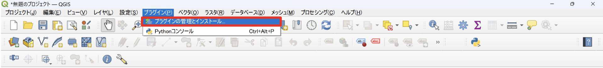

検索バーに「GreenInfraPlannerJP」と入力し、検索結果から「GreenInfraPlannerJP」を選択します。 
「インストール」ボタンをクリックし、インストールが完了すると、ツールバーにプラグインのアイコンが表示されます。

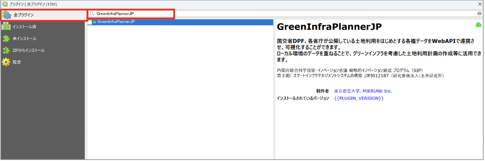

## 入手しているプラグインの ZIP ファイルからのインストールする場合

メニューバーから「プラグイン」→「プラグインの管理とインストール」を選択します。

左側のメニューから「ZIP からインストール」を選択し、「...」ボタンをクリックして、ダウンロードした ZIP ファイルを選択します。 
ZIP ファイルの選択ができたら「インストール」ボタンをクリックします。

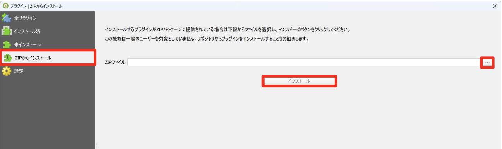

## プラグインの起動

メニューまたはツールバーよりGreenInfraPlannerJPを起動します。

## API キーの設定

「🔑」のアイコンをクリックし、必要な API キー設定欄に API キーを入力します。入力が完了したら「OK」ボタンを押してください。 
※API キーは、外部のデータサービスを利用するための「認証コード」です。
このプラグインでは、地図データや地理情報を取得するために必要となりますので、各サイトからご自身で発行手続きをしてください。

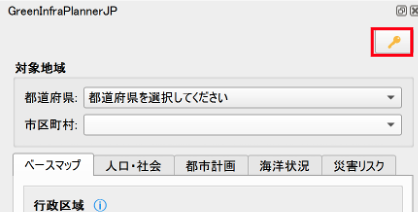

## 対象地域の選択

「都道府県」と「市区町村」をプルダウンから選択してください。 
市区町村は都道府県を選択するとプルダウンから選択ができるようになります。

{width=70%}

{width=70%}

## ベースマップの設定

### 行政区域の設定

行政区域データの表示に関する設定を行います。 
以下の項目から、表示したい行政区域のタイプを選択してください。

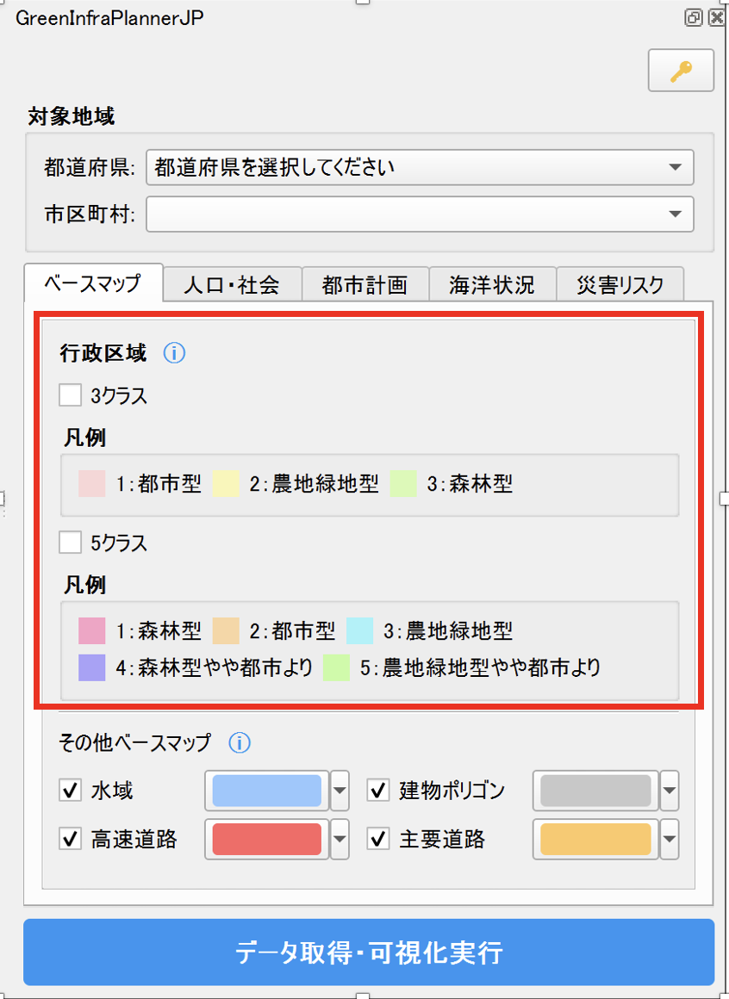

**ベース（白）**

- 行政区域を白色のポリゴンで表示します（カテゴリによる色分けなし）

**クラス3**

- 行政区域を3区分で色分けして表示します

**クラス5**

- 行政区域を5区分で色分けして表示します

### その他ベースマップの選択

可視化したい項目にチェックを入れてください。 
初期設定では全てにチェックが入っているので、不要なデータはもう一度クリックしてチェックを外してください。

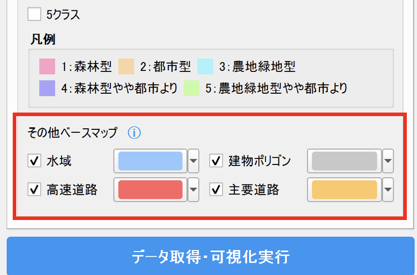

各項目で可視化されるデータは以下の通りです。

**水域**

- 水域（河川、湖沼など）
- 表示範囲：ズームレベル 9 以上

**高速道路**

- 高速自動車道
- 高速自動車道トンネル
- 表示範囲：ズームレベル 7 以上

**主要道路**

- 主要な道路
- 表示範囲：ズームレベル 9 以上

**建物ポリゴン**

- 普通建物（ズームレベル 16 以上）
- 堅ろう建物
- 高層建物
- 普通無壁舎（ズームレベル 16 以上）
- 堅ろう無壁舎
- 表示範囲：ズームレベル 14 以上

### 使用データに関する情報について

「その他ベースマップ設定」の文字の横の「ⓘ」にカーソルを合わせると接続している API の情報を見ることができます。

## API データの可視化

このプラグインでは、「人口・社会」「都市計画」「海洋状況」「災害リスク」の 4 つのカテゴリーから、必要なデータを選択して可視化できます。

### 人口・社会タブ

画面上部の「人口・社会」タブをクリックすると、人口や社会に関するデータを選択できます。

**政府統計(e-Stat)**

- 人口メッシュ(3 次メッシュ)
- 人口メッシュ(4 次メッシュ)

**不動産情報ライブラリ**

- 人口集中地区(DID)

### 都市計画タブ

画面上部の「都市計画」タブをクリックすると、都市計画に関するデータを選択できます。

**不動産情報ライブラリ**

- 都市計画区域/区域区分
- 用途地域
- 立地適正化計画
- 地区計画
- 高度利用地区
- 自然公園地域

### 海洋状況タブ

画面上部の「海洋状況」タブをクリックすると、海洋や港湾に関するデータを選択できます。

**海しる**

- 海岸線
- 港湾区域
- 漁港区域

### 災害リスクタブ

画面上部の「災害リスク」タブをクリックすると、災害リスクに関するデータを選択できます。

**ハザードマップポータルサイト**

- 洪水浸水想定区域（想定最大規模）

### 使用データに関する情報について

各カテゴリー名の横の「ⓘ」（インフォメーションアイコン）にカーソルを合わせると、接続している API やデータ提供元の情報を見ることができます。

## データ取得・可視化の実行

可視化したいデータにチェックを入れたら、画面下部の「データ取得・可視化実行」ボタンをクリックします。 
実行中はメッセージバーに「読み込み中: 処理中です...」と表示されます。処理が完了するまでそのままお待ちください。 

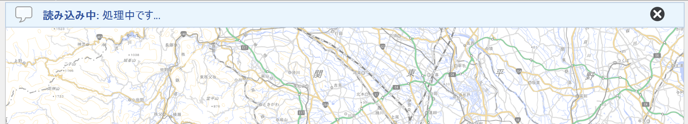

 
データの取得が完了すると、地図上にデータが表示されます。

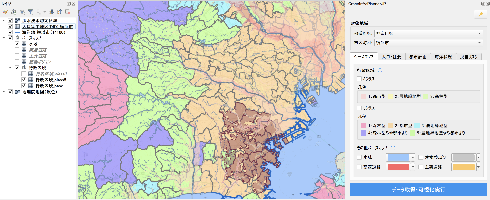

### 注意事項

- データの取得には時間がかかる場合があります
- 選択する地域の範囲や、チェックを入れたデータの数によって、処理時間が変わります
- 必要な API キーが設定されていない場合、該当するデータは取得できません

## 補足情報：QGIS でのレイヤー表示設定

取得したデータは QGIS のレイヤーとして追加されます。レイヤーの色や透明度などの表示設定を変更することで、より見やすい地図を作成できます。

### レイヤープロパティで色や透過度を変更する

レイヤーパネルで、設定を変更したいレイヤーを右クリックし、「プロパティ」を選択してください。 
レイヤープロパティダイアログの左側メニューから「シンボロジ」を選択すると、以下の設定ができます。

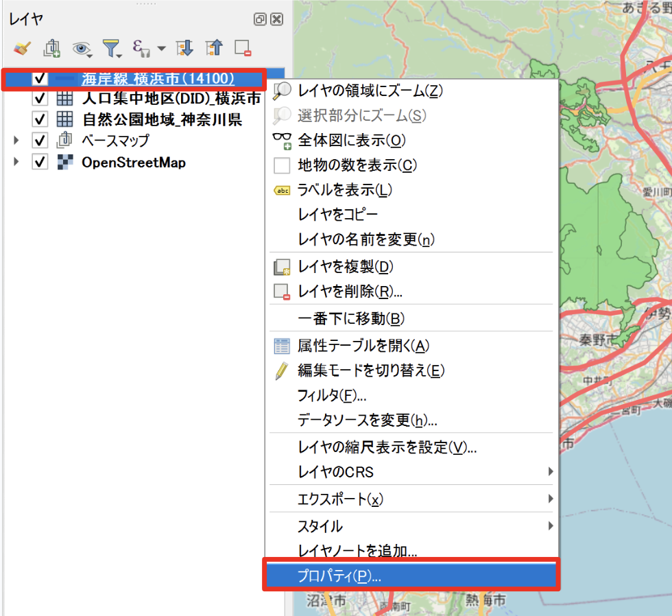

**色の変更**

1. カラーボックスをクリックします
2. 色選択ダイアログで好みの色を選択します
3. 「OK」ボタンをクリックして確定します

**透明度の変更**

1. 不透明度」スライダーを調整します
2. 0%（完全に透明）から 100%（完全に不透明）の範囲で設定できます
3. 複数のレイヤーを重ねて表示する場合、透明度を調整することで下のレイヤーを透かして見ることができます

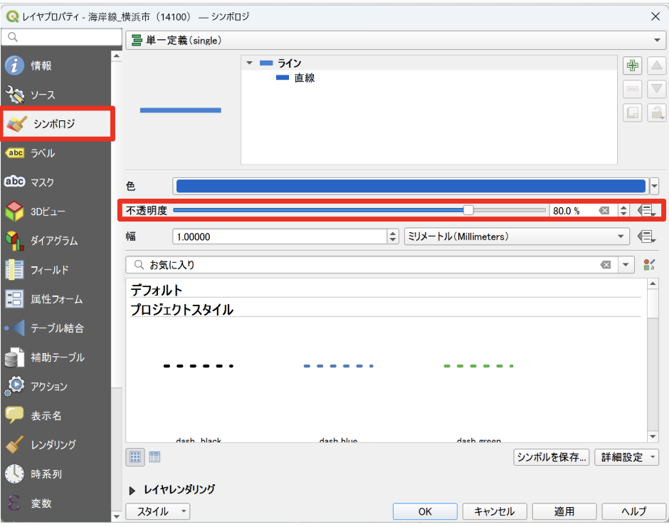

**線の太さやスタイルの変更**
ラインレイヤー（道路など）の場合：

- 「幅」で線の太さを調整できます
- 「線の種類」で実線、破線、点線などを選択できます

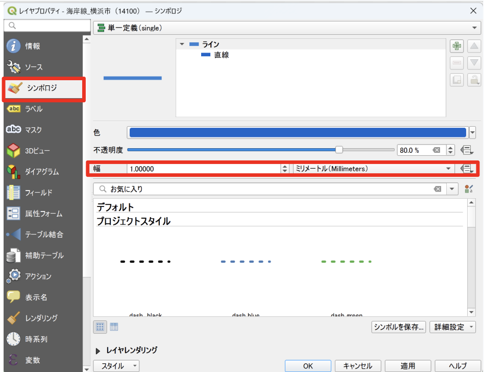

設定が完了したら「OK」ボタンをクリックして変更を適用してください。
