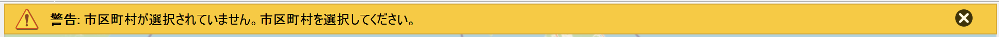
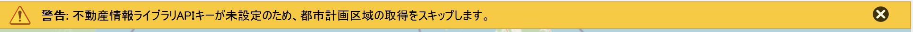
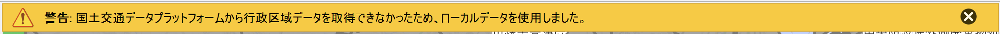
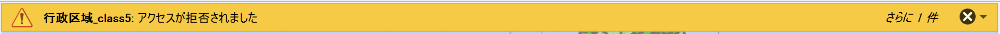

# 表示される警告やエラーについて

データ取得・可視化の実行中に、以下のようなメッセージが表示されることがあります。
それぞれの対処方法を確認してください。

| メッセージバー | 対処方法 |
|--------------|---------|
|  | 対象地域を選択していない場合に表示されます。「対象地域の選択」で都道府県と市区町村を選択してから、再度「データ取得・可視化実行」ボタンをクリックしてください。|
|  | APIキーが設定されていない場合に表示されます。画面右上の「🔑」アイコンをクリックして、該当するサービスのAPIキーを入力して「保存」をしてください。|
|  | APIキーが間違っていたり、有効期限が切れている可能性があります。APIキー設定画面で正しいキーが入力されているか確認、サービス提供元のウェブサイトでAPIキーの状態を確認をしてください。|
|  | 国土交通データプラットフォームの API キーが未設定、または API からデータを取得できなかったため、プラグインに同梱されているローカルデータで行政区域を表示した場合に表示されます。行政区域は表示されますが、「6クラス」は表示されません。「6クラス」を表示する場合は、「🔑」アイコンから国土交通データプラットフォームの API キーを設定してください。|
|  | QGIS が配信元からタイルを読み込む際、海域などタイルが配信されていない場所のタイルを取りに行こうとした際にこの警告が表示されます。プラグインの動作には影響はありません。
